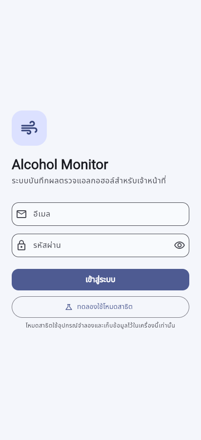
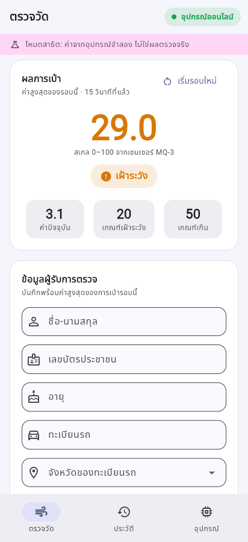
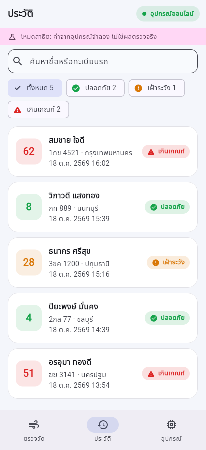
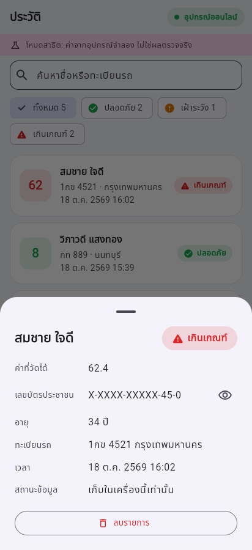
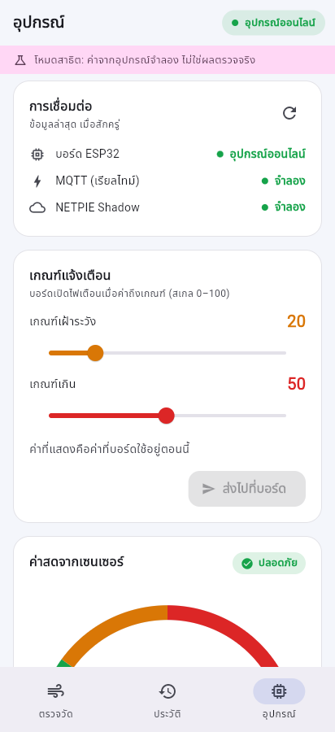
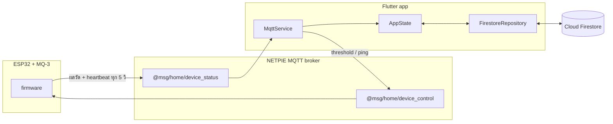

# Alcohol Monitor

แอป Flutter สำหรับเจ้าหน้าที่ใช้บันทึกผลตรวจแอลกอฮอล์จากเครื่องวัด IoT (ESP32 + เซนเซอร์ MQ-3) รับค่าแบบเรียลไทม์ผ่าน NETPIE จำค่าสูงสุดของการเป่าแต่ละครั้ง และเก็บประวัติลง Cloud Firestore โดยต้องเข้าสู่ระบบก่อน ถ้าเน็ตหลุด แอปเก็บข้อมูลไว้ในเครื่องแล้วส่งขึ้น cloud ให้ภายหลัง

ผลงานรายวิชา 02739342 Application Development for Mobile Devices · โค้ดฝั่งบอร์ดอยู่ที่ [alcohol-monitor-firmware](https://github.com/Catboyz-45/alcohol-monitor-firmware)

**ลองใช้ได้ทันที:** [เว็บเดโม](https://catboyz-45.github.io/alcohol-monitor-app/) → กด **"ทดลองใช้โหมดสาธิต"** (ใช้อุปกรณ์จำลอง ไม่ต้องมีบอร์ดหรือบัญชี)

| เข้าสู่ระบบ | ตรวจวัด | ประวัติ | รายละเอียด | อุปกรณ์ |
| --- | --- | --- | --- | --- |
|  |  |  |  |  |

## ความสามารถหลัก

- **ค่าสดจากบอร์ด** ผ่าน NETPIE MQTT (TLS) ใช้ credential ของแอปเองชุดเดียว ไม่ต้องฝัง token ของบอร์ดไว้ในแอป
- **จำค่าสูงสุดของการเป่า** บอร์ดค้างค่าบนจอแค่ 2.5 วินาที แอปจึงจำค่าสูงสุดไว้ให้บันทึกได้ทัน
- **รู้ว่าบอร์ดออฟไลน์** แยกสถานะ "ออนไลน์ / ไม่ส่งข้อมูล / เชื่อมต่อไม่ได้" ไม่ใช่แค่ดูว่า API ตอบหรือไม่
- **ตั้งเกณฑ์แจ้งเตือนจากแอป** และรอให้บอร์ดยืนยันว่ารับค่าแล้ว
- **บันทึกแบบ offline-first** ถ้าส่งขึ้น cloud ไม่สำเร็จ รายการจะเข้าคิวและส่งใหม่อัตโนมัติ (ลบก็เช่นกัน)
- **ปกป้องข้อมูลส่วนบุคคล** ต้องล็อกอินด้วย Firebase Auth และ Firestore Security Rules ให้เฉพาะเจ้าหน้าที่ที่ได้รับสิทธิ์ ส่วนเลขบัตรประชาชนจะถูกปิดไว้ในหน้าประวัติ
- **ตรวจเลขบัตรประชาชนด้วย checksum** และเลือกจังหวัดได้ครบ 77 จังหวัด
- **โหมดสาธิต** ใช้อุปกรณ์จำลอง มีปุ่ม "จำลองการเป่า" ลองครบทุกขั้นตอนได้โดยไม่ต้องมีฮาร์ดแวร์
- รองรับ Android, iOS, macOS และ Web ทั้งธีมสว่างและธีมมืด

## สถาปัตยกรรม



### ข้อตกลงข้อมูลระหว่างแอปกับบอร์ด

| Topic (MQTT) | ทิศทาง | Payload |
| --- | --- | --- |
| `@msg/home/device_status` | บอร์ด → แอป | `{bac, raw, threshold1, threshold2, alertLevel, millis}` ส่งเมื่อมีการเป่า, heartbeat ทุก 5 วินาที และตอบ ping |
| `@msg/home/device_control` | แอป → บอร์ด | `{threshold1, threshold2}` ตั้งเกณฑ์ หรือ `{ping: 1}` ขอสถานะทันที |

- `bac` คือค่าสเกล 0–100 ที่แปลงเชิงเส้นมาจาก ADC (0–4095) **ยังไม่ใช่ค่า BAC ตามกฎหมาย**
- `alertLevel` คือ 0 (ปลอดภัย), 1 (เฝ้าระวัง, ≥ threshold1), 2 (เกินเกณฑ์, ≥ threshold2) ใช้กติกาเดียวกันทั้งสองฝั่ง ถ้า payload ไม่มี field นี้ แอปจะคำนวณเอง
- แอปถือว่าบอร์ดเงียบไปเมื่อไม่มีข้อความเกิน 12 วินาที (heartbeat หลุดได้ 1 รอบ) และถ้า MQTT หลุดจะแสดงว่าไม่ได้เชื่อมต่อทันที
- แอปและบอร์ดเป็นคนละ device ใน NETPIE แต่ต้องอยู่ **group เดียวกัน** ถึงจะส่ง `@msg` ถึงกันได้

> ต้องใช้ firmware รุ่นที่มี heartbeat และตอบ ping (ตั้งแต่ [alcohol-monitor-firmware#1](https://github.com/Catboyz-45/alcohol-monitor-firmware/pull/1)) ถ้าใช้ firmware รุ่นเก่า แอปจะได้ข้อมูลเฉพาะตอนมีการเป่า และจะขึ้นว่าบอร์ดเงียบในช่วงที่ไม่มีการเป่า

ตัวแปลง payload อยู่ที่ [`lib/device_reading.dart`](lib/device_reading.dart) และมีเทสต์ครอบทุกรูปแบบที่ firmware ส่ง

## เริ่มต้นใช้งาน

ต้องมี Flutter SDK (Dart ≥ 3.7)

```bash
git clone https://github.com/Catboyz-45/alcohol-monitor-app.git
cd alcohol-monitor-app
flutter pub get
flutter run -d chrome   # ไม่ต้องตั้งค่าอะไร จะเปิดเป็นโหมดสาธิต
```

### ต่อกับบอร์ดจริงและ Firebase

```bash
cp config.example.json config.json   # config.json อยู่ใน .gitignore แล้ว
flutter run --dart-define-from-file=config.json
```

| ค่า | ใช้ทำอะไร |
| --- | --- |
| `APP_MQTT_CLIENT_ID` / `APP_MQTT_USER` / `APP_MQTT_PASSWORD` | Client ID / Token / Secret ของ **device ฝั่งแอป** ใน NETPIE (สร้างแยกจากบอร์ด แต่อยู่ group เดียวกัน) |
| `APP_MQTT_PORT` / `APP_MQTT_TLS` | ค่าเริ่มต้นคือ `1884` และ TLS เปิดอยู่ (ใช้กับแอป native ส่วนเว็บใช้ `APP_MQTT_WS_URL`) ถ้าต่อไม่ได้ให้ลอง `1883` และ `false` |
| `APP_FIREBASE_PROJECT_ID` / `APP_FIREBASE_API_KEY` | เปิดการล็อกอินและซิงก์กับ Firestore (ไม่ใส่ = เก็บประวัติในเครื่องอย่างเดียว) |

### ตั้งค่า Firebase

1. เปิด **Authentication → Email/Password** และสร้างบัญชีเจ้าหน้าที่ใน Firebase Console
2. ถ้าไม่ต้องการให้คนอื่นสมัครเองได้ ให้ปิด **Authentication → Settings → User actions → Enable create (sign-up)**
3. สร้างเอกสาร `officers/{uid}` ใน Firestore ให้แต่ละบัญชีที่อนุญาต (จะใส่ field อะไรก็ได้ เช่น `{ "name": "..." }`)
4. Deploy Security Rules ใน [`firestore.rules`](firestore.rules):

```bash
firebase deploy --only firestore:rules --project <your-project-id>
```

### บัญชีทดลอง

เว็บเดโมไม่ต้องใช้บัญชี กด "ทดลองใช้โหมดสาธิต" ได้เลย ส่วนบัญชีสำหรับทดสอบกับ Firebase จริง ให้สร้างตามขั้นตอนด้านบน แล้วเพิ่ม `officers/{uid}` ให้บัญชีนั้น

## การทดสอบ

```bash
flutter analyze
flutter test
```

ทดสอบ Firestore Security Rules (ต้องมี Node 22 และ Java 21):

```bash
cd firestore-tests && npm ci && npm test
```

ทุก PR รัน format check, analyze, test และ build web ผ่าน GitHub Actions ([`.github/workflows/ci.yml`](.github/workflows/ci.yml)) เทสต์ครอบคลุม:

- การแปลง payload ทุกรูปแบบที่ firmware ส่ง (ผลวัด, heartbeat, ค่าที่เป็น string, JSON ที่เสีย)
- คิวซิงก์ offline: บันทึกหรือลบตอน cloud ล่มแล้วข้อมูลต้องไม่หายหรือโผล่กลับมา และไม่เก็บเลขบัตรเต็มของรายการที่ซิงก์แล้วไว้ในเครื่อง
- การตรวจว่าบอร์ดออนไลน์หรือเงียบไป การจำค่าสูงสุด และการยืนยัน threshold
- Firebase Auth (login, refresh token, ข้อความ error) และ Firestore REST (pagination, Bearer token, 403)
- Widget test ของฟอร์ม (checksum เลขบัตร), การบันทึกที่ขึ้นในประวัติแบบปิดเลขบัตร, ปุ่มจำลองการเป่า และหน้า login
- **Firestore Security Rules** ทดสอบกับ Firestore Emulator ([`firestore-tests/`](firestore-tests/)) ว่าคนนอก `officers` อ่านไม่ได้ และข้อมูลผิดรูปแบบเขียนไม่ได้

## Deploy เว็บเดโม

เว็บเดโม build แบบไม่มี credential (จึงเป็นโหมดสาธิตเสมอ) ขั้นตอน deploy:

1. เปิด **Settings → Pages → Source: GitHub Actions**
2. ไปที่แท็บ **Actions → Deploy demo → Run workflow**

## โครงสร้างโค้ด

```text
lib/
├── main.dart                  # AuthGate + สร้าง AppState/DeviceLink ต่อ session
├── config.dart                # ค่าคอนฟิกจาก --dart-define รวมไว้ที่เดียว
├── device_reading.dart        # โมเดล + ตัวแปลง payload จากบอร์ด (สัญญาข้อมูลกับ firmware)
├── device_link.dart           # NETPIE MQTT และอุปกรณ์จำลอง
├── mqtt_service.dart          # MQTT พร้อม auto-reconnect, ส่ง threshold และ ping
├── auth_service.dart          # Firebase Auth ผ่าน REST (เก็บ refresh token)
├── firestore_repository.dart  # Firestore REST + Bearer token
├── app_state.dart             # ประวัติ + คิวซิงก์ offline + สถานะอุปกรณ์
├── thai_id.dart               # ตรวจ checksum / ปิดเลขบัตรประชาชน
├── *_page.dart                # หน้า login, ตรวจวัด, ประวัติ, อุปกรณ์
└── widgets/                   # เกจ, ป้ายสถานะ, ส่วนประกอบที่ใช้ร่วมกัน
```

## ข้อจำกัดและสิ่งที่ควรรู้

- เป็นต้นแบบเพื่อการเรียนรู้ ไม่ใช่เครื่องวัดที่ผ่านการรับรอง ค่า 0–100 ยังไม่ได้สอบเทียบเป็น BAC จึงห้ามใช้ตัดสินทางกฎหมาย
- token ของ device ฝั่งแอปที่ใส่ผ่าน `--dart-define` จะฝังอยู่ในแอปที่ build ออกไป ถ้าโดนแกะไป คนอื่นจะส่ง threshold หรืออ่านค่าได้ แต่ปลอมเป็นบอร์ดไม่ได้ ถ้าจะใช้จริงควรมี backend ที่ถือ token แทนแอป
- เลขบัตรประชาชนของรายการที่ซิงก์แล้วจะเก็บในเครื่องแค่ 3 หลักท้าย ต้องออนไลน์ถึงจะดูเลขเต็มได้
- Firebase Web API key ไม่ใช่ความลับ ความปลอดภัยของข้อมูลมาจาก Auth และ Security Rules
- ประวัติในเครื่องเก็บใน SharedPreferences แบบไม่เข้ารหัส (รายการที่ยังรอส่งยังมีเลขบัตรเต็ม) และจะถูกล้างเมื่อออกจากระบบ

## ผู้พัฒนา

[Catboyz-45](https://github.com/Catboyz-45)
